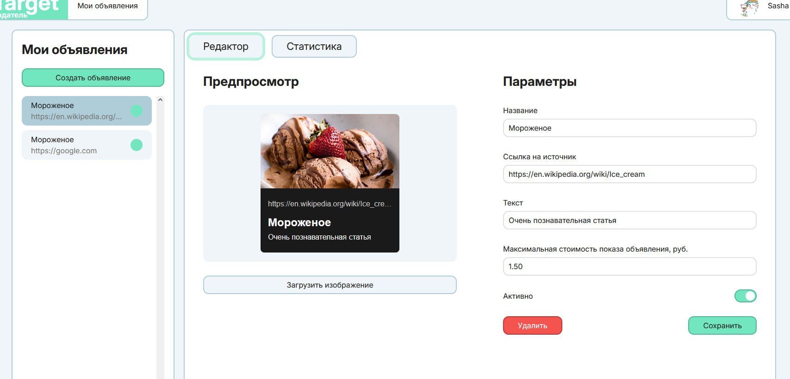
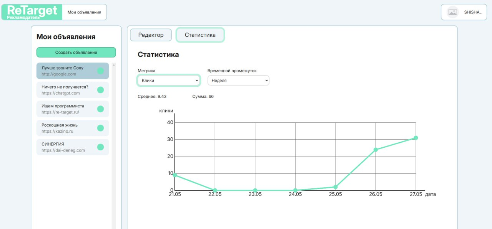
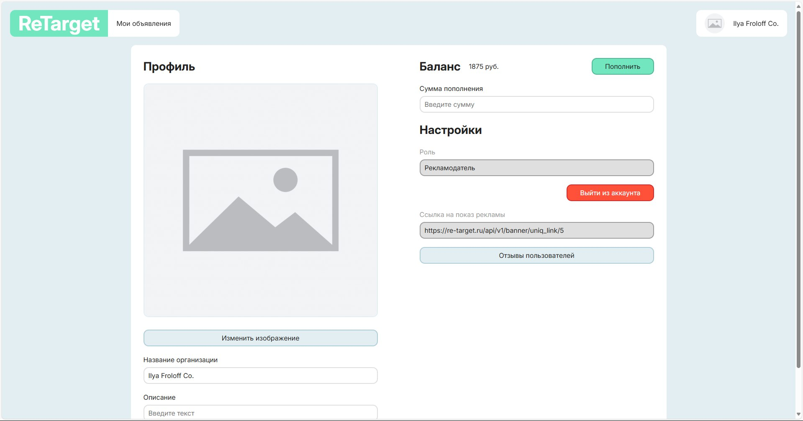
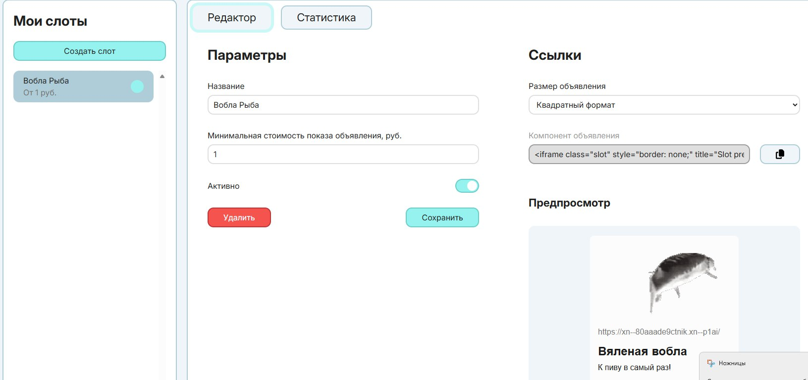
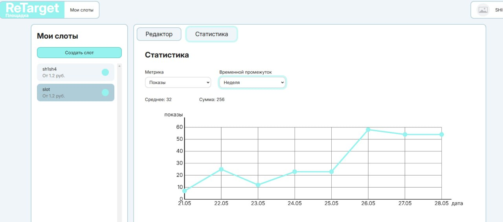
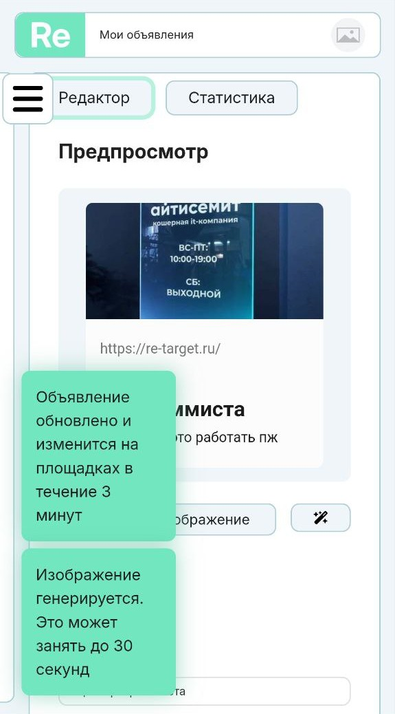
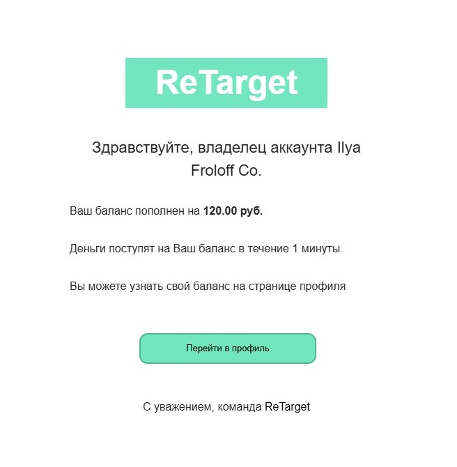

# Фронтенд проекта "Реклама" команды RePresent

## Авторы

- [**Александр Волощук**](https://github.com/DeveloperMan313)
- [**Илья Фролов**](https://github.com/Ifroloff)
- [**Анатолий Сюсюкин**](https://github.com/kiberperdun)
- [**Алексей Шишкин**](https://github.com/SH1SH4)

## Менторы

- **Софья Ситниченко** - _Фронтенд_
- **Никита Гуреев** - _Бэкенд_
- **Дарья Крылова** - _UI/UX_
- **Вадим Оленников** - _СУБД_

## Описание проекта

Ркламный агрегатор ReTarget позволяет рекламодателям создавать рекламные объявления, а площадкам - слоты, для показа объявлений. Система ранжирования распределяет объявления на подходящие слоты. Страница статистики позволяет рекламодателям и площадкам оценивать эффективность своих объявлений/слотов.

Фронтенд создан на TypeScript с минимальными зависимостями (handlebars, sass, webpack).

### Особенности

- ML-алгоритмы ранжирования рекламных объявлений (объявление подбирается с учетом ограничений стоимости, а также описания объявлений и описания площадки, владеющей слотом)
- Email-уведомления о регистрации аккаунта, пополнении баланса и низком балансе кошелька
- Адаптация UI под десктопные и мобильные устройства

### Возможности

Для рекламодателей:

- Создание рекламных объявлений с изображениями, описаниями и максимальной стоимостью показа
- Отслеживание статистики просмотров, кликов и денежных затрат на конкретное объявление
- Опциональная ИИ-генерация изображений к объявлениям по их описанию
- Настраиваемые лимиты email-предупреждений о низком балансе кошелька
- Пополнение кошелька через ЮKassa

Для площадок, показывающих объявления:

- Создание рекламных слотов с названиями, форматами отображения (квадратный или прямоугольный) и минимальной стоимостью показа объявления
- Отслеживание статистики просмотров, кликов и дохода с конкретных слотов
- Указание описания площадки для улучшения релевантности показываемых объявлений
- Вывод средств с кошелька

## Скриншоты

Рекламодатель, настройки объявления



Рекламодатель, статистика кликов по объявлению



Рекламодатель, настройки профиля



Площадка, настройки слота



Площадка, статистика показов слота



Сайт на мобильном устройстве



Email-уведомление о пополнении кошелька



## Инструкция по запуску

Зависимости:

- git
- docker

```bash
git clone https://github.com/frontend-park-mail-ru/2025_1_RePresent
cd ./2025_1_RePresent

# С помощью Docker

docker compose up -d

# Либо вручную

# Установить зависимости
npm install

# Использовать .env файл
export $(cat .env)
# или задать переменные в консоли
export ORIGIN=https://re-target.ru PRODUCTION=true

# Запустить сборку
npm run build
```

## Ссылки:

[Бэкенд проекта](https://github.com/go-park-mail-ru/2025_1_RePresent)

[Figma](https://www.figma.com/design/HHsrThhfky5yVolIUAWnUD/ReTarget?node-id=0-1&t=YSXfSl5ah6THeQCT-1)
